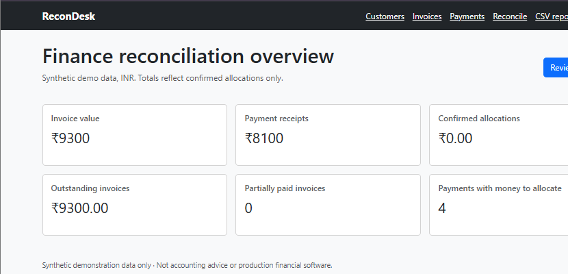
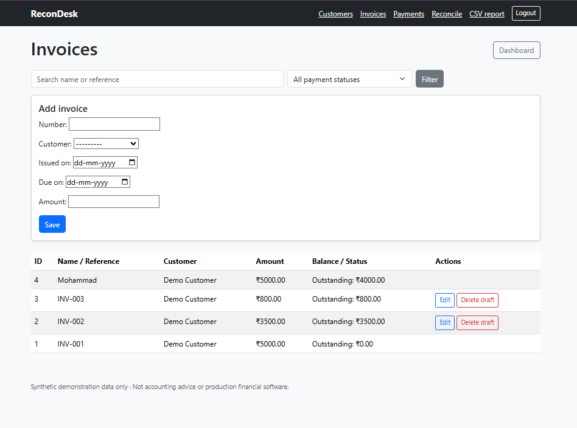
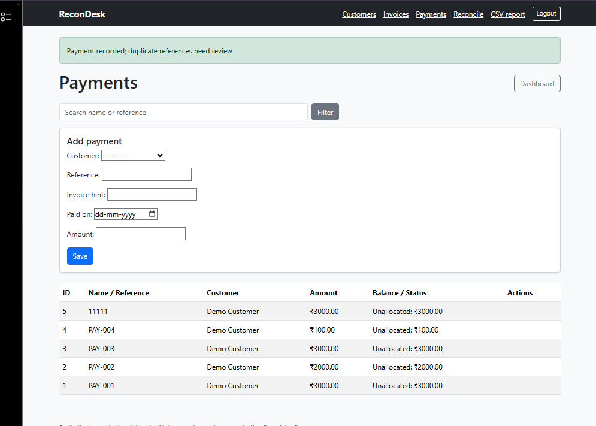
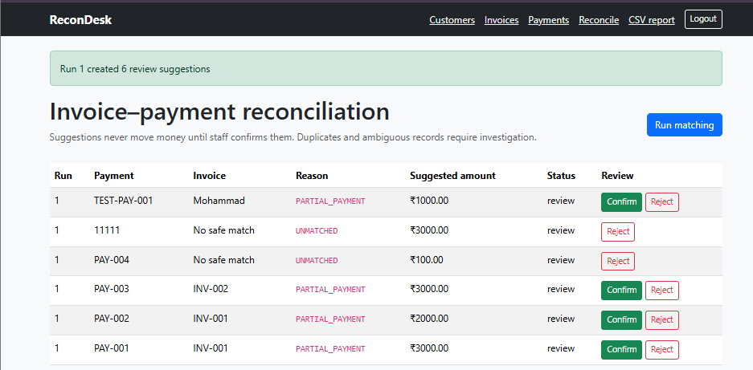
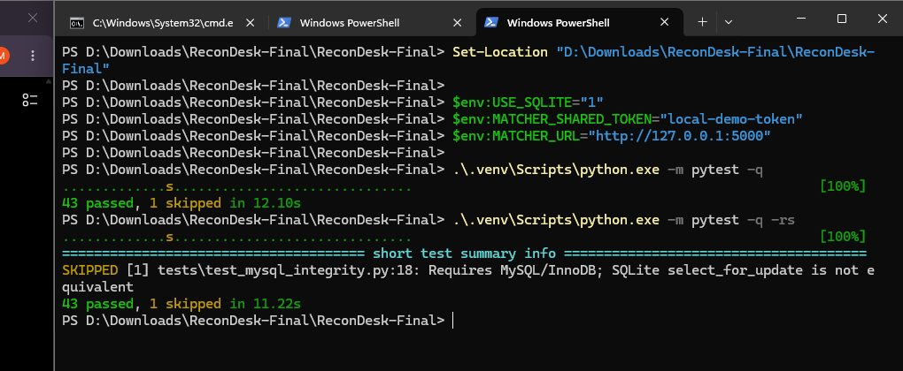
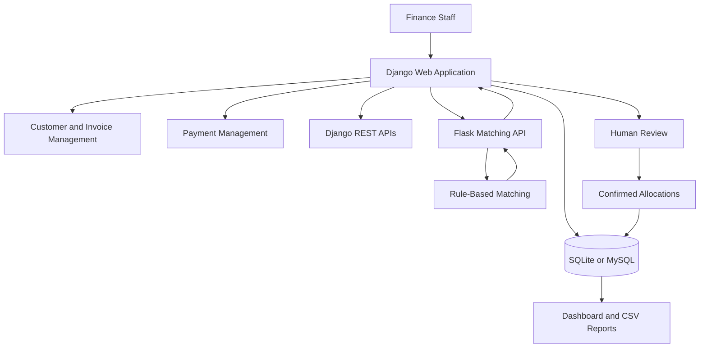
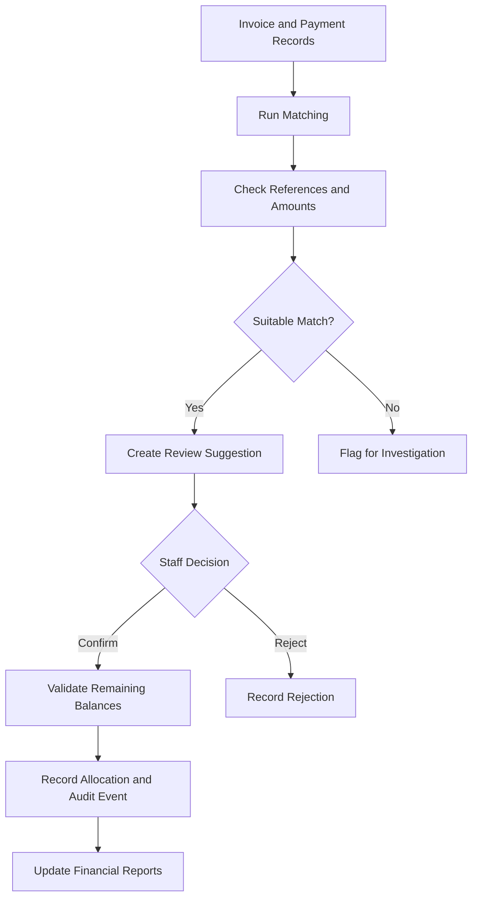

<div align="center">

# ReconDesk

### Know exactly which invoices have been paid.

**A small-business invoice and payment reconciliation application built with Django, Flask and SQL.**

Record invoices, track payments, review explainable matching suggestions, confirm allocations and monitor outstanding balances.


[](https://github.com/yusufthecoder474/ReconDesk-Final/actions/workflows/ci.yml)

**[Features](#features) · [Screenshots](#application-screenshots) · [Installation](#run-locally-without-docker) · [Testing](#testing-and-verified-results) · [Architecture](#system-architecture)**

</div>

> **Project scope:** Final-year software engineering project built with synthetic financial data. ReconDesk is intended for demonstration and learning, not production accounting or banking operations.

## The problem

Small businesses often manage invoices and received payments in separate spreadsheets.

Consider a customer who receives an invoice for ₹5,000 but pays ₹3,000 today and ₹2,000 later. Without reliable reconciliation, the business may struggle to identify whether the invoice is fully paid.

Other common problems include duplicate payment references, incorrect invoice numbers, partial payments, unmatched receipts and inaccurate outstanding balances.

ReconDesk provides a simple web application that helps finance staff investigate these issues and confirm payment allocations.

## Features

| Feature | Description |
|---|---|
| Customer management | Create and manage customer records |
| Invoice management | Record, search and filter invoices |
| Payment management | Record customer payments and references |
| Reconciliation | Suggest invoice-payment matches using Flask |
| Manual approval | Confirm or reject suggested allocations |
| Partial payments | Track outstanding invoice balances |
| Duplicate detection | Identify potentially repeated references |
| Financial dashboard | View invoice totals, receipts and allocations |
| CSV reporting | Export invoice-level reconciliation details |
| Audit events | Record important reconciliation decisions |
| REST APIs | Django REST Framework and Flask integration |
| Testing | Pytest, Django tests and financial validation |

## Application screenshots

These screenshots were captured from the application running locally on Windows 11.

### Finance dashboard



The dashboard displays invoice value, payment receipts, confirmed allocations, outstanding invoices and payments awaiting allocation.

### Invoice management



Invoices can be recorded, searched and filtered. Outstanding balances update when payments are confirmed.

### Payment management



Payment records include customer information, payment references, optional invoice hints and unallocated balances.

### Invoice-payment reconciliation



The reconciliation page displays suggested invoice-payment matches, explanation codes, amounts and manual confirmation actions.

In one local run, the application generated six review suggestions, including partial-payment and unmatched cases.

### Automated tests



The Windows/SQLite test run completed with **43 passed, 0 failed and 1 skipped**.

## Verified business workflow

The following workflow was demonstrated locally using synthetic records:

1. Create a ₹5,000 invoice.
2. Record a ₹1,000 payment.
3. Request matching through the Flask API.
4. Review the suggested invoice allocation.
5. Confirm the payment in Django.
6. Verify that the outstanding invoice balance decreases to ₹4,000.

A second test confirmed two payments against invoice `INV-001`:

| Payment | Amount | Remaining balance |
|---|---:|---:|
| Original invoice | ₹5,000 | ₹5,000 |
| PAY-001 | ₹3,000 | ₹2,000 |
| PAY-002 | ₹2,000 | ₹0 |

This demonstrates multiple payments against one invoice.

## Financial reporting results

The exported CSV contained:

| Invoice | Total | Allocated | Outstanding |
|---|---:|---:|---:|
| INV-001 | ₹5,000 | ₹5,000 | ₹0 |
| INV-002 | ₹3,500 | ₹0 | ₹3,500 |
| INV-003 | ₹800 | ₹0 | ₹800 |
| Mohammad | ₹5,000 | ₹1,000 | ₹4,000 |
| **Total** | **₹14,300** | **₹6,000** | **₹8,300** |

The totals reconcile:

**₹14,300 = ₹6,000 allocated + ₹8,300 outstanding**

These values come from one local synthetic demonstration. They are not production business results.

## Technology stack

| Layer | Technology |
|---|---|
| Programming | Python 3.12 |
| Primary backend | Django 5.2 |
| REST API | Django REST Framework |
| Matching service | Flask 3.1 |
| Frontend | HTML, CSS, Bootstrap, Django templates |
| Local database | SQLite |
| MySQL target | MySQL 8.4 / InnoDB |
| Analytics | SQL, Pandas |
| Testing | Pytest, pytest-django |
| Development tools | Git, GitHub, PowerShell |
| CI configuration | GitHub Actions |

## System architecture



Django manages users, financial records, approvals and reports.

Flask handles matching suggestions through a separate REST endpoint. It does not directly modify the financial database.

Financial allocations occur only after confirmation by an authorized user.

## Database design

The project includes these models:

- Customer
- Invoice
- Payment
- PaymentAllocation
- ReconciliationRun
- ReconciliationSuggestion
- AuditEvent

Relationships are managed using Django ORM models and database constraints.

## How matching works



The matching process uses deterministic rules and explanation codes. It is not an AI or machine-learning system.

Ambiguous and unmatched payments require human investigation.

## Run locally without Docker

### Requirements

- Windows 11
- Python 3.12
- PowerShell
- Internet connection for installing dependencies

Docker and MySQL are not required for the initial SQLite setup.

### 1. Open PowerShell in the project directory

```powershell
Set-Location "D:\Downloads\ReconDesk-Final\ReconDesk-Final"
```

### 2. Install dependencies

```powershell
Set-ExecutionPolicy -Scope Process Bypass
.\scripts\setup_windows.ps1
```

### 3. Start Flask

Open a separate PowerShell window:

```powershell
Set-Location "D:\Downloads\ReconDesk-Final\ReconDesk-Final"
Set-ExecutionPolicy -Scope Process Bypass
.\scripts\start_flask.ps1
```

Flask should run at:

http://127.0.0.1:5000

### 4. Start Django

Open another PowerShell window:

```powershell
Set-Location "D:\Downloads\ReconDesk-Final\ReconDesk-Final"

$env:USE_SQLITE="1"
$env:DEBUG="1"
$env:MATCHER_URL="http://127.0.0.1:5000"
$env:MATCHER_SHARED_TOKEN="local-demo-token"

.\.venv\Scripts\python.exe manage.py migrate
.\.venv\Scripts\python.exe manage.py runserver 127.0.0.1:8081
```

The shared token must match the Flask service configuration.

### 5. Create an admin account

In another PowerShell window:

```powershell
Set-Location "D:\Downloads\ReconDesk-Final\ReconDesk-Final"
$env:USE_SQLITE="1"

.\.venv\Scripts\python.exe manage.py createsuperuser
```

### 6. Open ReconDesk

http://127.0.0.1:8081/accounts/login/

Sign in using the superuser account.

If you encounter unapplied model changes, generate and apply migrations before running the server.

For MySQL configuration, see `docs/MYSQL_SETUP.md`.

## Testing and verified results

Run the test suite:

```powershell
Set-Location "D:\Downloads\ReconDesk-Final\ReconDesk-Final"

$env:USE_SQLITE="1"
$env:MATCHER_URL="http://127.0.0.1:5000"
$env:MATCHER_SHARED_TOKEN="local-demo-token"

.\.venv\Scripts\python.exe -m pytest -q -rs
```

### Verified results (November 5, 2026)

| Check | Verified result |
|---|---|
| Windows 11 / Python 3.12 / SQLite | Django and Flask started without Docker; login, invoice creation, payment recording and reconciliation demonstrated |
| Local Pytest | **43 passed, 1 skipped, 0 failed** (MySQL-only lock test skipped) |
| GitHub Actions SQLite job | **43 passed, 1 deselected**; Ruff, Django checks and migrations passed |
| GitHub Actions MySQL 8.4 job | **44 passed, 0 failed**; includes InnoDB-specific concurrency test |
| Financial reconciliation / CSV | Four synthetic invoices: ₹14,300 invoiced, ₹6,000 allocated, ₹8,300 outstanding |
| GitHub Actions pipeline | **Both jobs passed** on commit `755547df` |
| Production deployment and security review | Not performed |

**[Inspect successful CI run #2](https://github.com/yusufthecoder474/ReconDesk-Final/actions/runs/42074401700)** · [CI workflow](.github/workflows/ci.yml)

The SQLite suite deliberately excludes the MySQL-only concurrency test because SQLite does not implement equivalent `SELECT FOR UPDATE` locking. That test **passed under MySQL 8.4 on GitHub Actions**. CI results validate the tested scenarios, not production readiness or performance at scale.

## Agile and SDLC

ReconDesk includes documentation for:

- Software requirements
- User stories
- Product backlog
- Sprint scopes
- Acceptance criteria
- Architecture
- Database design
- Test planning
- Requirements traceability
- Release preparation

The repository follows a practical software development life cycle:

**Requirements → Design → Implementation → Testing → Verification → Documentation**

The sprint documents describe planned work scopes and should not be interpreted as evidence of historical Scrum ceremonies.

## Research component

### Research question

How accurately can explainable rule-based reconciliation identify invoice-payment matches compared with exact-reference matching on synthetic data?

The project includes:

- A simple baseline matcher
- A rule-based matching approach
- Synthetic evaluation data
- Reproducible evaluation scripts
- Analysis of incorrect and ambiguous matches

The experiment is educational. Results do not establish a new reconciliation algorithm or real-world performance.

See `EVALUATION_RESULTS.md` and `docs/RESEARCH.md`.

## Project structure

```text
ReconDesk/
├── core/
├── config/
├── flask_matcher/
├── templates/
├── static/
├── tests/
├── scripts/
├── docs/
│   └── screenshots/
│       ├── dashboard.png
│       ├── invoices.png
│       ├── payments.png
│       ├── reconciliation.png
│       └── tests.png
├── data/
├── .github/
│   └── workflows/
├── manage.py
├── requirements-windows.txt
├── README.md
└── LICENSE
```

## Known limitations

- SQLite alone cannot establish MySQL transaction safety; an InnoDB-specific concurrency test passed in CI, but broader multi-user and production-load testing has not been performed.
- Matching rules may suggest incorrect records when references are misleading.
- Staff must review suggestions before confirming allocations.
- The application does not integrate with real bank accounts.
- It does not provide a complete general ledger or financial accounting platform.
- Synthetic evaluation results should not be treated as production metrics.
- Production deployment and independent security testing remain future work.

## License

Released under the MIT License. See `LICENSE`.

---

<div align="center">

**ReconDesk — Clearer invoice tracking, explainable payment matching and human-reviewed reconciliation.**

Built as a final-year software engineering project with Python, Django, Flask and SQL.

</div>
