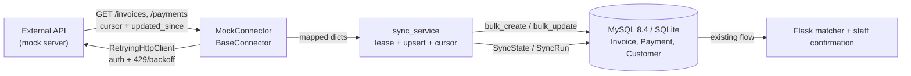

# SaaS Connector Layer

ReconDesk pulls invoices and payments from an external API into its
own database, so the existing reconciliation logic (Django → Flask
matcher → staff confirmation) runs unchanged on extracted data.
The connector layer is an extension: no existing model behaviour,
matching rule, or API contract was changed to add it.

## Why a mock server (and how Stripe would replace it)

The concrete connector talks to a **local mock server**
(`connectors/mock_server.py`), a Stripe-shaped JSON API with
deterministic data. Stripe test mode and the GitHub API were
considered and rejected for this project:

| Option | Why not used here |
| --- | --- |
| Stripe test mode | Needs a secret key and a Stripe account, is not deterministic for 429 / pagination / incremental cases, and cannot run in CI without a secret. |
| GitHub API | Real, but its data is repos/issues, not invoices/payments — the mapping would be forced, and CI would depend on GitHub's rate limits. |
| **Local mock server** | Deterministic, runs offline in CI, and can deliberately return cursor pages, a 429 with `Retry-After`, and changed records. No real secrets needed. |

The swap point is small and explicit: change `MOCK_CONNECTOR_BASE_URL`
and auth in config, and replace the two functions in
`connectors/mapping.py` with Stripe's invoice/payment fields
(`invoices.list` / `charges.list` with `starting_after` as the
cursor and `created[gt]` as the incremental bound). `fetch_page`,
`sync`, the lease, and the upsert code do not change — that is the
point of the interface below.

## Architecture



### Design principles (SOLID)

- **Single responsibility, one module per concern:** `auth.py`
  (headers only), `http_client.py` (retries only), `mapping.py`
  (translation only, no DB), `sync_service.py` (persistence only),
  `mock_connector.py` (endpoints only), `mock_server.py` (test data only).
- **Open/closed:** a second connector is a new `BaseConnector`
  subclass + mapping functions. No change to retry, lease, or upsert code.
- **Dependency inversion / injection:** the HTTP session is injected
  into `RetryingHttpClient`, and the client into the connector.
  Tests inject a fake session; production injects `requests.Session`.
  Config is a plain dataclass built from env vars (`from_env`), so
  tests construct it directly with no environment.
- **Interface segregation:** `BaseConnector` exposes exactly five
  operations — `authenticate`, `fetch_page`, `extract`,
  `map_to_internal`, `sync` — and nothing else.

### Files

| File | Job |
| --- | --- |
| `connectors/base.py` | Abstract `BaseConnector` + `Page` |
| `connectors/config.py` | `ConnectorConfig`, env-only secrets |
| `connectors/auth.py` | Basic / Bearer / API-key headers |
| `connectors/http_client.py` | Pagination transport, retries |
| `connectors/mapping.py` | External → internal, pure functions |
| `connectors/mock_connector.py` | Concrete connector (mock API) |
| `connectors/mock_server.py` | Deterministic mock API (Flask) |
| `connectors/sync_service.py` | Lease, customers, upserts, cursor |
| `connectors/models.py` | `ConnectorSyncState`, `ConnectorSyncRun` |
| `connectors/management/commands/sync_connector.py` | `manage.py sync_connector` |
| `connectors/views.py`, `connectors/api_urls.py` | Staff-only sync API |
| `scripts/benchmark_sync.py` | Per-row vs bulk benchmark |

**No new dependencies were added.** The connector uses `requests`
and `Flask`, both already in `requirements.txt`.

## Authentication

Selected by config (`MOCK_CONNECTOR_AUTH_TYPE`): `bearer`
(`Authorization: Bearer <token>`), `basic`
(`Authorization: Basic base64(user:password)`), or `api_key`
(`X-API-Key: <token>`). Secrets come from environment variables
only — see `.env.example` — and are never logged, printed, or
returned in an error message. `ConnectorConfig.validate()` fails
fast if the chosen scheme's secret is missing. A 401/403 from the
API raises `ConnectorAuthError` immediately with **no retry**.

### How OAuth 2.0 would plug in (documented only, not built)

OAuth 2.0 fits the same seam, in this order:

1. Add `auth_type="oauth2"` and config fields for `client_id`,
   `client_secret`, `token_url`, and `scope` (env vars only).
2. In `auth.py`, add a `get_oauth2_headers(config, token_store)`
   that returns `Authorization: Bearer <access_token>`, refreshing
   the token first when it is expired.
3. Token exchange (authorization-code grant for a user-facing
   connector, client-credentials grant for a server-to-server one)
   happens in `BaseConnector.authenticate()`: POST the grant to
   `token_url`, store `access_token`, `refresh_token`, and
   `expires_at` — in the database (encrypted at rest) or a secret
   store, never in a file or log.
4. Refresh on 401: the HTTP client retries once after refreshing,
   then fails. The refresh must be serialised per connector (reuse
   the sync lease) so two threads do not exchange the same refresh
   token twice.
5. Nothing else changes: pagination, mapping, upserts, and the
   cursor are auth-agnostic.

## Pagination, rate limits, retries

- `fetch_page(resource, cursor, updated_since)` fetches one page;
  `sync` follows `next_cursor` until it is `null`. The mock API
  paginates by last-seen id (`cursor`) with `limit`, and also
  supports page-style parameters if a provider returns
  `page`/`total_pages` — the client passes both through.
- **429 / 503 with `Retry-After`:** the header value wins, capped
  at `backoff_max` (30 s).
- **Other 5xx / transport errors:** exponential backoff with full
  jitter — `sleep(uniform(0, min(backoff_max, base * 2**attempt)))`,
  `base` 0.5 s by default — up to `max_retries` (3) retries.
- **4xx other than 429:** no retry. 401/403 is an auth error, not a
  retryable one.

## Incremental sync and data extraction

`ConnectorSyncState` holds one row per connector:
`last_synced_at` + `last_external_id`. The first run (`--full`, or
no stored cursor) fetches everything; later runs pass
`updated_since=<last_synced_at>` and fetch only records with
`updated_at` newer than the cursor. The cursor advances only after
a successful run, inside a `SELECT ... FOR UPDATE` transaction, and
only forward — a failed run leaves the old cursor in place, so the
next run re-fetches the same window instead of silently skipping it.

The mock dataset's `updated_at` values are strictly increasing (one
minute per record), so `updated_since` is unambiguous there. For a
provider with non-unique timestamps, the stored `last_external_id`
is the tie-break: fetch `updated_at >= cursor AND (updated_at,
id) > (cursor, last_id)`. That is why both fields are stored.

Mapping lives in one module (`connectors/mapping.py`) and is pure:
raw dict in, plain dict out. Amounts reuse `core.logic.money`, so
external amounts get exactly ReconDesk's own validation (positive,
≤ 2 decimals). A record that fails mapping raises `MappingError`;
the sync logs it (record id, field, reason — capped at 50 samples
in the run's `details`) and continues with the next record. It
never crashes the run.

## Idempotency

`Invoice` and `Payment` gained nullable `source` + `external_id`
with a unique `(source, external_id)` constraint (migration
`core/migrations/0003_...`). Manual rows have both NULL and are
unaffected (MySQL and SQLite treat NULLs as distinct in a unique
index). A re-run upserts on that pair: same external id, no new
row. The sync also skips protected rows instead of changing them:
a finalized invoice or an allocated payment whose external values
differ is logged as skipped, never overwritten (verified by test).

## Concurrency safety

Two mechanisms, both in the database, not in process memory:

1. **Lease:** `ConnectorSyncRun.active_key` is UNIQUE and NULLable.
   The winning run sets it to the connector name while live and
   clears it (NULL) on finish. A second starter hits the unique
   constraint and gets an `already_running` run row instead of
   writing anything. Many finished runs (NULL) can coexist.
2. **Cursor lock:** the `ConnectorSyncState` row is locked with
   `SELECT ... FOR UPDATE` while the cursor advances.

The InnoDB test (`tests/test_connectors_mysql.py`, MySQL-only)
starts two simultaneous full syncs and asserts: exactly 100
invoices + 100 payments, no duplicate `external_id`, 200 creates
across both runs, and no live run left behind.

A lease left by a crashed process is stale, not permanent:
`manage.py sync_connector mock --force` clears it (operator
action), and `clear_stale_lease()` clears runs older than 60
minutes. Either way the cleared run is marked `failed` with a
reason, not silently deleted.

## Customer resolution

Approved default, in `sync_service.resolve_customer` /
`_resolve_customers_batch`: match by email first, then by name;
otherwise create the customer from the external name/email. The
run's `details` records how many customers were created, so no
customer is created silently. Customers are resolved in bulk per
page (one email lookup, one name lookup, one `bulk_create`), not
one query per record.

## Running it

```bash
# Terminal 1 — mock API (port 5001, token mock-test-token)
MOCK_API_TOKEN=mock-test-token python -m connectors.mock_server

# Terminal 2 — Django (SQLite for a first run)
export USE_SQLITE=1 DEBUG=1
export MOCK_CONNECTOR_BASE_URL=http://127.0.0.1:5001
export MOCK_CONNECTOR_API_TOKEN=mock-test-token
python manage.py migrate
python manage.py sync_connector mock --full   # first run: full load
python manage.py sync_connector mock          # later runs: incremental
python manage.py sync_connector mock --full --no-bulk  # per-row mode
```

Staff API (session auth, staff only):

| Method | Endpoint | Result |
| --- | --- | --- |
| POST | `/api/connectors/sync/` `{"full": true}` | 201 run summary, 200 if already running, 503 on failure |
| GET | `/api/connectors/runs/` | Last 20 runs |

A sync triggered via the API runs synchronously in the request.
A production deployment would queue it (Celery/RQ) instead; that
is out of scope for this project.

## Performance (measured, not guessed)

`scripts/benchmark_sync.py` syncs N records (half invoices, half
payments) from the mock server on a fresh test database, once with
per-row `save()` and once with bulk upserts, and reports wall time
and DB query count (counted with an `execute_wrapper` — see the
note below). Both modes share the batched customer resolution, so
the difference measured is the write path alone.

Measured 2026-11-18 on this VM (SQLite, Python 3.12, single runs;
a repeat run gave the same query counts and times within 5%).
Full results: `scripts/benchmark_results.json`.

| Records | Mode | Time | Queries | Rows/s | Queries/record |
| ---: | --- | ---: | ---: | ---: | ---: |
| 1,000 | per-row | 1.400 s | 3,520 | 714 | 3.52 |
| 1,000 | bulk | 0.113 s | 32 | 8,820 | 0.03 |
| 10,000 | per-row | 13.935 s | 35,083 | 718 | 3.51 |
| 10,000 | bulk | 1.238 s | 203 | 8,076 | 0.02 |

Bulk is **12.4× faster at 1k records and 11.3× at 10k**, with
110× / 173× fewer queries. The bottleneck that was optimised is
real: per-row `save()` costs ~3.5 queries per record (unique
validation + insert + related lookups), while bulk mode writes a
whole page in a handful of `executemany` calls. The batched
customer resolution in `sync_service.py` was part of the same fix:
it removed the per-record customer lookups that used to dominate
the bulk path.

> Measurement note: the first version of the benchmark used
> `CaptureQueriesContext`. That was wrong — Django's query log is
> a bounded deque, and at 10k records it overflowed and reported
> 0 queries for the bulk run. The script now counts with an
> `execute_wrapper`, and the numbers above are from the corrected
> script. Do not quote the earlier (wrong) run.

## Testing

| Suite | Count | What it covers |
| --- | --- | --- |
| `tests/test_connectors.py` | 24 | Mocked HTTP: auth headers, config validation, 429 + `Retry-After`, exponential backoff timing, max-retry cap, 401/404 no-retry, cursor pagination, mapping success/errors, idempotent re-run, incremental cursor, mapping-error logging, customer-by-email, finalized-invoice skip, active-run refusal |
| `tests/test_connectors_integration.py` | 6 | Live mock server: full sync (200 rows), 429 retried end to end, Basic auth, incremental sync after a dataset change, management command, staff-only API |
| `tests/test_connectors_mysql.py` | 1 | Two simultaneous syncs on MySQL 8.4/InnoDB |
| Existing suite | 43 | Unchanged, still passing |

Run: `USE_SQLITE=1 python -m pytest -q -m "not mysql"` (SQLite),
`python -m pytest -q` on MySQL 8.4 (CI job `MySQL 8.4`).

## Limitations (honest)

- The MySQL concurrency test has **not** been run locally: this
  VM has no MySQL server and its Docker daemon is not running.
  It is written to run in the GitHub Actions MySQL 8.4 job, which
  is the verification for it — do not claim it passed until that
  job is green.
- No live Stripe/GitHub call has been made; the mock server is the
  only provider exercised. The Stripe swap is a documented design
  point, not a tested integration.
- OAuth 2.0 is documented only (see above); no token exchange or
  refresh code exists.
- The API-triggered sync is synchronous; a long sync blocks that
  request. The management command is the recommended trigger.
- Incremental sync relies on the provider's `updated_at` being
  monotonic; providers without a reliable updated timestamp need
  a full re-scan (upsert makes that safe, just slower).
